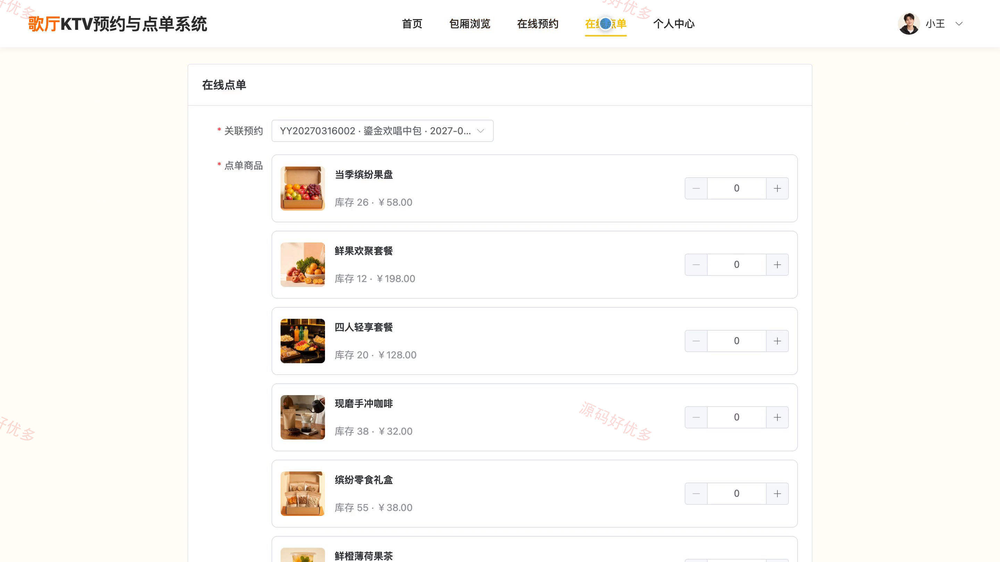
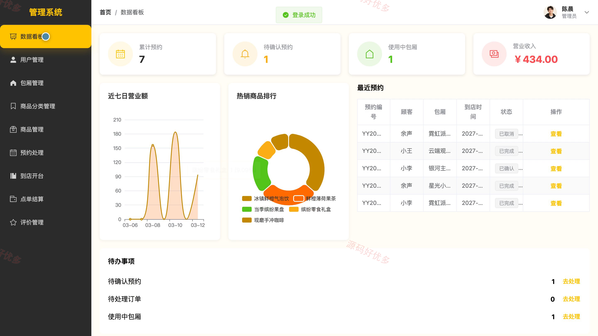
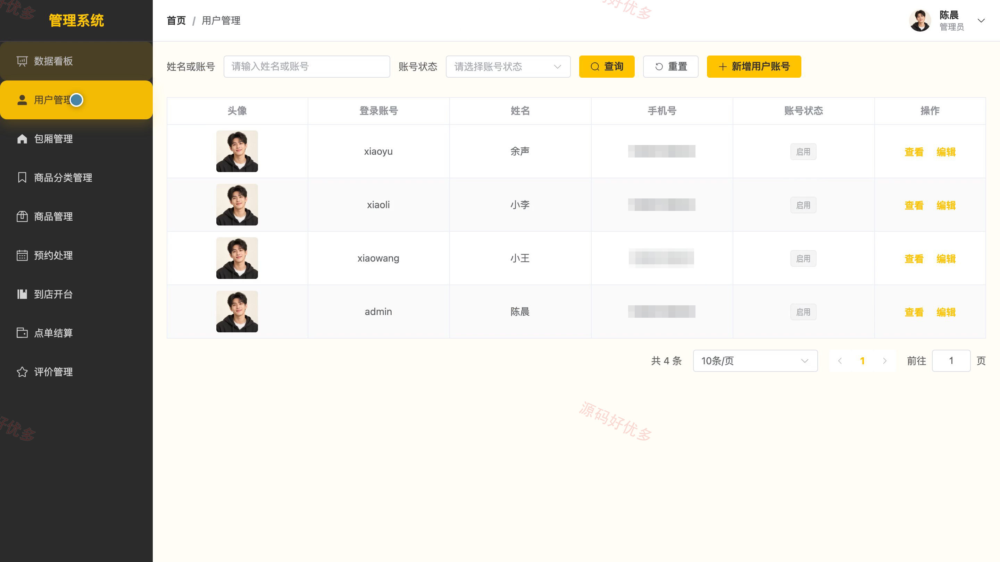
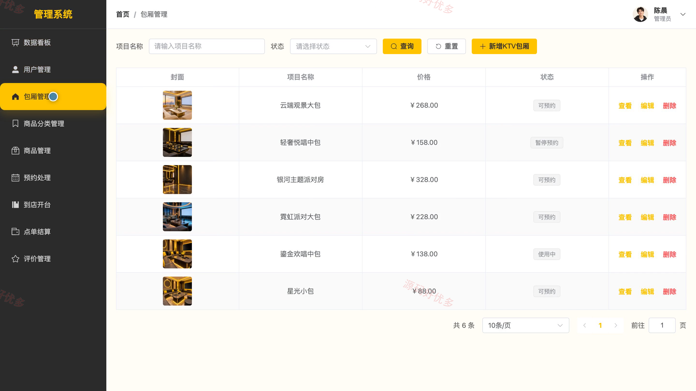
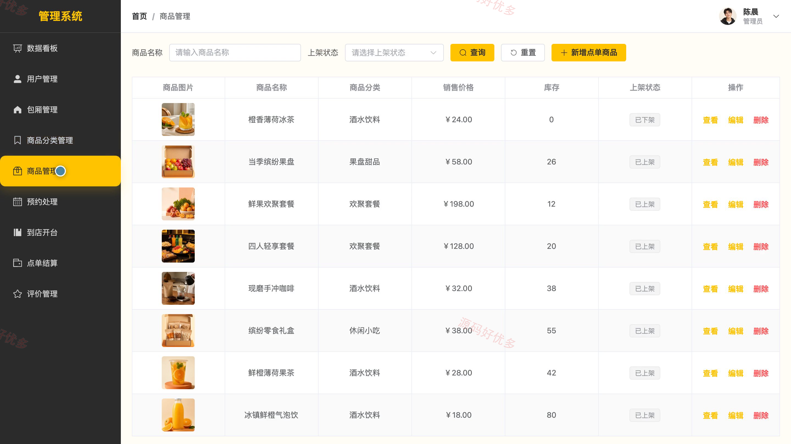

# bs120A
bs120A歌厅KTV预约与点单系统
## 源码问题查看主页咨询

### 一、关键词
KTV预订、包厢预约、在线点单、欢唱娱乐、酒水套餐

### 二、作品包含
源码+数据库+万字设计文档+PPT+全套环境和工具资源+本地部署教程

### 三、项目技术
前端技术： Html、Css、Js、Vue3.4、Element-Plus
后端技术：Java、SpringBoot3.2.0、MyBatis-Plus

### 四、运行环境要求
开发工具：IDEA/eclipse + VSCODE

数据库：MySQL5.7+（共13张表）

数据库管理工具：Navicat10以上版本

环境配置软件： JDK17 + Maven3.6

前端Nodejs：16+

浏览器：谷歌浏览器

### 五、项目介绍
项目编号：bs120A

歌厅KTV预约与点单系统面向顾客和管理员，围绕包厢浏览、时段预约、到店开台、酒水小吃点单、消费结算与评价反馈形成完整业务闭环。顾客可在线选择包厢、提交预约并关联预约点单，管理员通过后台处理预约、维护包厢和商品、完成开台结算并查看营业数据。

角色：顾客、管理员

顾客功能：账号注册与登录、包厢分类筛选与详情查看、在线选择时段并预约包厢、预约进度查询与取消、酒水小吃及套餐浏览、关联当前预约在线点单、消费订单明细与状态查询、消费评分与意见反馈。

管理员功能：预约订单与包厢经营看板、顾客账号查询与启停管理、包厢类型价格容量及图片管理、商品分类价格库存及上下架管理、预约确认拒绝与处理说明登记、到店开台与包厢状态更新、点单处理与线下结算登记、顾客评价维护与营业统计。

### 六、运行截图

